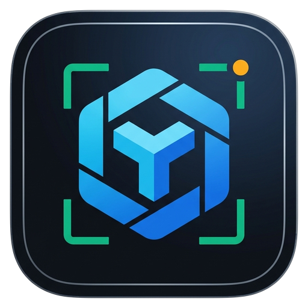

<p align="center">
  
</p>

# YOLO26 视频抽帧与训练工具 (YoloStudio)

面向 **录制视频 → 抽帧 → 内嵌 X-AnyLabeling 标注工作台 → LLM 智能标注 → YOLO26 训练 / 验证 / 推理 / 导出** 的单进程一体化桌面 GUI 工具（同时提供 CLI 命令行入口）。

## 核心功能

1. **视频抽帧**：支持单视频或文件夹批量抽帧，提供按秒间隔、按帧步长、按目标帧数均匀抽帧、起止时间裁剪、相似帧去重、分辨率限制与实时画面预览。
2. **单进程内嵌 X-AnyLabeling 标注工作台**：在「2. 标注工作台」标签页内直接托管原版 X-AnyLabeling（`PyQt6` + `onnxruntime-gpu`），无需额外寻找或启动 `.exe`；支持人工画框与 SAM / YOLO 等 GPU AI 辅助标注，并与前后标签页一键联动打开目录、导入 `classes.txt` 或定位单张图片。
3. **LLM 智能标注（预标质检、补漏与标准收框）**：支持 **基准模型预标 + LLM 质检精修** 或 **已有标注 (`.json`) + LLM 质检精修** 两种来源，集成 **Google Gemini API (`google-genai`)** 与 **OpenAI 兼容多模态接口**（通义千问 Qwen-VL / 硅基流动 / 本地 Ollama / vLLM），提供一键连接测试与环境变量检测；自动绘制编号框 + 局部裁剪图送检，剔除误检、修正错类、发现/补充漏标，并支持 **LLM 标记松框 / LLM 局部精修收框 / 本地 SAM 像素级标准收框**（含安全门禁与虚线原框对比），结果分流至 `auto_passed` / `llm_fixed` / `need_review`，支持分流筛选、加载历史报告回看及双击结果行直接跳转内嵌工作台精修。
4. **数据集转换与校验**：同时支持 **X-AnyLabeling 原生 `.json`** 与 **导出的 YOLO `.txt` + `classes.txt`**，自动校验、统计类别并划分为 `train/val/test` 生成 `data.yaml`。
5. **YOLO26 目标检测训练与评估导出**：支持 `yolo26n.pt` / `yolo26s.pt` / `yolo26m.pt` / `yolo26l.pt` / `yolo26x.pt` 及自定义 `.pt` 权重，内置场景超参数预设（通用自然场景 / 游戏与 UI 弱增强 / 小样本微调）、优化器与数据增强细粒度调节及任意附加参数透传，训练日志完整输出提交配置与实际生效超参数，支持安全停止、断点续训、验证推理预览；评估与导出页可自动读取 `.pt` 权重的训练尺寸与类别顺序并同步提示，独立配置导出尺寸（方形/矩形）、`batch`、`dynamic`、`nms` 模式、`opset`、`simplify` 与 `FP16`，并同步提供 CLI `export` 子命令支持导出 `ONNX`、`TorchScript`、`TensorRT` 等部署格式。

## 开源协议

因与原版 **X-AnyLabeling** 进行单进程源码级集成，本项目整体采用 **GNU General Public License v3.0 (`GPL-3.0-only`)** 开源协议，详见 [LICENSE](LICENSE) 与 [THIRD_PARTY_NOTICES.md](THIRD_PARTY_NOTICES.md)。

## 快速启动

双击运行 `run_gui.bat`，或执行：

```powershell
.venv\Scripts\python.exe main.py
```

安装或更新依赖（含 `PyQt6`、`PyQt6-WebEngine` 及本地可编辑安装的 `third_party/X-AnyLabeling[gpu]`）：

```powershell
.venv\Scripts\python.exe -m pip install -r requirements.txt
```

> 注意：`ultralytics` 依赖 `opencv-python`，X-AnyLabeling 依赖 `opencv-contrib-python-headless`，两者都会写入同一个 `cv2` 包而互相覆盖。安装或更新依赖后请执行以下命令，只保留后者（它已包含本项目需要的全部 OpenCV 功能）：
>
> ```powershell
> .venv\Scripts\python.exe -m pip uninstall -y opencv-python opencv-contrib-python-headless
> .venv\Scripts\python.exe -m pip install --no-deps opencv-contrib-python-headless
> ```
>
> 之后 `pip check` 会提示 `ultralytics` 缺少 `opencv-python`，可以忽略。

## 独立便携整合包发布（面向无 Python 电脑）

针对未安装 Python 或 CUDA Toolkit 的目标 Windows x64 电脑，可执行以下命令构建免安装绿色便携整合包（含无黑框原生启动器 `YoloStudio.exe` 与 `YoloStudio-CLI.cmd`）：

```powershell
# 日常代码迭代极速发版（约 55 秒）：仅编译核心 .pyd + 启动器并输出 ~5.6 MiB 热更新补丁包
.\scripts\build_portable.ps1 --bump patch --patch-only --variant cpu --protect pyd --archive 7z

# 依赖未变更时复用已预编译 runtime/ 底座快速产出完整包（配合 --compression fast 提速归档）
.\scripts\build_portable.ps1 --mode clean --variant gpu --protect pyd --reuse-runtime --download-weights yolo26n.pt yolo26s.pt --archive 7z --compression fast --patch-archive

# 首次全新构建完整包（默认开启 --protect pyd 防查看防篡改；对外按 GPLv3 开源分发请附加 --protect none）
.\scripts\build_portable.ps1 --mode clean --variant gpu --protect pyd --download-weights yolo26n.pt yolo26s.pt --archive 7z
```

## 项目文档

完整索引见 [项目文档索引.md](项目文档索引.md)：
- [001_录制视频抽帧工具使用说明.md](docs/001_录制视频抽帧工具使用说明.md)
- [002_YOLO26训练使用说明.md](docs/002_YOLO26训练使用说明.md)
- [003_独立便携整合包构建与发布说明.md](docs/003_独立便携整合包构建与发布说明.md)
