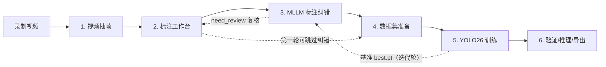

# 002 YOLO26 训练与 MLLM 纠错使用说明

本文档介绍如何结合 **X-AnyLabeling** 与 **多模态大语言模型（MLLM）纠错清洗**，将抽帧后的图片高效制作成高质量 **YOLO26** 数据集，并在本地 GPU 上完成训练、验证、推理预览与模型导出。

---

## 1. 整体工作流

标签页按“采集 → 标注 → 质检 → 组装 → 训练 → 评估”排列，主流程从左到右推进：



- **第一轮（基准阶段）**：少量人工标注后可跳过第 3 步，直接 `2 → 4 → 5` 训出基准 `best.pt`；若已有 `.json` 标注，也可在第 3 步用“读取已有 .json + MLLM 复核”模式先做一次质检（不需要权重）。
- **迭代轮**：训练产出的 `best.pt` 自动带入「3. MLLM 标注纠错」，低阈值自动标注后由 MLLM 纠错/收框清洗，结果分流为：
  - `auto_passed`：高置信度/无误通过；
  - `llm_fixed`：MLLM 自动改类/删误检/标准收框；
  - `need_review`：疑似漏标/框偏松待精修 → 回到「2. 标注工作台」重点复核。
- 清洗结果发送到「4. 数据集准备」合并生成新数据集，再进入「5. YOLO26 训练」与「6. 验证/推理/导出」。

---

## 2. 使用内嵌 X-AnyLabeling 工作台进行标注（基准阶段 / 复核阶段）

1. 切换到软件的 **「2. 标注工作台 (X-AnyLabeling)」** 标签页（或在「1. 视频抽帧」完成后自动跳转），点击顶部 **「打开图片目录...」** 选择要标注的目录。
2. 工作台直接在单进程内加载原版 X-AnyLabeling，无需额外配置外部 `.exe` 路径；如需利用显卡运行 AI 辅助标注（如 SAM / YOLO），安装依赖时已默认配备 CUDA 12 `onnxruntime-gpu`。
3. 如已有预置类别清单，可点击顶部 **「导入 classes.txt...」** 加载类别名称。
4. 在工作台中进行目标检测标注：
   - 按 `R` 创建矩形框（Rectangle），框选目标后输入或选择类别名，按 `Ctrl+S` 保存（或开启自动保存）。
   - **两种保存/导出方式均直接支持**：
     - **方式一（推荐，最省事）**：直接在工作台正常保存即可（默认在每张图片同目录下生成同名 `.json` 标注文件）。
     - **方式二**：通过工作台顶部菜单导出为 YOLO 格式（`.txt` + `classes.txt`）。
5. 标注完成后点击顶部 **「发送到「4. 数据集准备」→」** 或 **「发送到「3. MLLM 纠错」→」** 继续下一步。

---

## 3. MLLM 自动标注纠错与漏标清洗（推荐）

当你已经用少量手动标注训练出了一个基准 `best.pt`（或已经在外部用脚本跑出了一批 `.json` 自动标注结果），可切换到 **「3. MLLM 标注纠错」** 标签页解决**错标**和**漏标**问题：

1. **选择数据来源**：
   - **基准模型低阈值推理 + MLLM 纠错（推荐）**：加载基准 `best.pt`，建议将 `低阈值 Conf` 设为 `0.08 ~ 0.15`，先把潜在的弱特征漏标尽可能框出来，再交给 MLLM 剔除误检与错类。
   - **读取已有 X-AnyLabeling `.json` + MLLM 复核**：直接扫描已有 `.json` 文件让 MLLM 逐张审核。
   - **包含子目录**：位于「图片目录」正下方且默认勾选（与标注工作台和数据集页保持一致），可直接处理按视频或分流子目录组织的数据；若清洗输出目录位于图片目录内部，会自动跳过其中的上一轮结果，避免重复审核。
2. **配置多模态大模型（MLLM）**：
   - **Google Gemini API (`google-genai`)**：默认支持 `gemini-3.8-flash`（均衡推荐）、`gemini-4-argon`（复杂场景高精度）、`gemini-3.5-flash-lite`（高吞吐低成本），可在界面填 Key 或设置环境变量 `GEMINI_API_KEY`。
   - **OpenAI 兼容接口**：内置常用预设（**通义千问 DashScope Qwen-VL**、**硅基流动**、**本地 Ollama**、**本地 vLLM**、**OpenAI 官方**），也可自定义 `Base URL` 与模型名（默认读取环境变量 `OPENAI_API_KEY`）。
   - **环境变量检测与一键测连通**：`API Key` 下方实时展示当前凭据来源（手动输入 / 已检测环境变量 / 本地接口免填 / 未配置），点击 **「测试连接」** 可在正式跑批量图片前快速验证 Key、网络代理与模型名是否可用；界面会自动记忆除 `API Key` 以外的常用参数配置（绝不明文保存密钥）。
3. **纠错、补漏与边框紧贴修正（Box Refine）策略**：
   - **目标类别清单**：英文逗号分隔（如 `person, helmet`），支持点击 **「导入 classes.txt」** 一键载入，留空则自动从基准模型或 `.json` 中提取。
   - **辅助判定规则**：可填写你的标注口径（例如“远景模糊人影不标”、“反光背心只标穿在身上的”），能明显降低 MLLM 误判。
   - **边框紧贴修正（解决预训练模型框偏松/包含过多背景）**：支持 4 种可选模式：
     - **关闭（仅删改/补漏）**：保持现有框坐标不变，只做误检剔除、类别修正与漏标检查。
     - **MLLM 标记松框入待复核 (`flag_loose`)**：让 MLLM 逐框评估紧贴度（`tight` / `loose` / `partial`）；发现偏松或截断的框不改动原坐标，直接标记为 `[Loose?]` 并分流至 `need_review/` 供人工精修。
     - **MLLM 局部放大图精修收框 (`mllm_crop`)**：自动将候选框外扩 20% 裁剪放大后送交 MLLM，在局部高分辨率视野内输出紧贴目标边缘的 `refined_box_2d` 坐标并映射回原图（开启此模式会自动强制附带局部裁剪放大图）。
     - **本地 SAM 像素级精准收框 (`sam_local`，推荐高精度标准画框)**：基于 `ultralytics.SAM`（支持 `sam2.1_t.pt` / `sam2.1_s.pt` / `sam2.1_b.pt` / `mobile_sam.pt` 或本地自定义 `.pt`，首次运行可自动下载）以原框为 Box Prompt 分割目标前景掩码并反算紧贴最小外接矩形；默认仅对 MLLM 判定为偏松的框收框，也可勾选 **「对所有保留框全量 SAM 收框」** 统一标准化全部有效框。
     - **安全门控保护**：所有自动收框均受面积缩放比（`0.18 ~ 1.35`）与 `IoU ≥ 0.20` 双重门控校验，一旦收框异常（如缩成噪声点或漂移到背景物体），自动拒绝修改并保留原框转入 `need_review/`，避免破坏标注质量。
   - **效率、并发与小批量试跑**：
     - 选定图片目录后下方实时显示待处理图片总数；建议首次调优规则或收框模式时点击 **「试跑 5 张」**（或调整 `上限` 数值框，CLI 可传 `--max-images 5`）先小批量验看效果，满意后再切回 `全部` 全量运行，避免误耗 API 额度。
     - 未勾选「检查漏标目标」且未启用 MLLM 审框紧贴度时，所有框置信度 `≥ 免审阈值` 的整图会直接跳过 MLLM 调用以省钱提速；开启漏标检查或收框评估时，该阈值自动切换为 `优先裁剪 <`（超额多目标图中优先放大低于该阈值的框）或停用。
   - **附带局部裁剪放大图**：自动将候选框外扩 20% 裁剪放大后一并送审，大幅提升小目标纠错与收框准确率。
   - **检查漏标目标 & 尝试直接补充漏标框**：MLLM 在核对现有框后还会巡检整图，发现未标注目标时尝试补充框并自动去重。
4. **结果分流、筛选回看与 X-AnyLabeling 联动复核**：
   - 清洗完成后会输出至三个子目录（同时生成 `classes.txt` 与 `review_report.json`）：
     - `auto_passed/`：全部框确认无误、紧贴且无漏标；
     - `llm_fixed/`：MLLM 自动删除了误检框、修正了错误类别或通过安全门控完成了紧贴收框；
     - `need_review/`：MLLM 检测到疑似漏标、新增了补充框、存在待人工精修的偏松/异常收框、给出了不在类别清单中的改类建议，或审核出错的疑难图片。
   - 右侧结果区提供 **实时计数分流筛选按钮**（`全部` / `自动通过` / `已删改/收框` / `待复核` / `出错`）及新增的 **`收框`** 统计列，方便快速聚焦 `need_review` 与已收框样本；「结果列表」与「运行日志」合并为同一区域的两个页签（运行失败或连接测试失败时自动切到日志页），省出空间给下方对比预览。左右两栏之间、结果区与预览区之间均可拖动分隔条调整比例。
   - 支持点击 **「加载历史报告...」** 重新载入任意历史输出目录中的 `review_report.json`，无需重新请求 MLLM 即可继续对比预览或双击跳转工作台精修。
   - 在右侧表格单击任意一行即可即时查看 **「Before vs After」对比图**（上方附带各状态框色图例，右侧 After 图以**虚线**标出收框前原框、**天青实线 `[Tight]`** 标出收紧后标准框，待复核松框以洋红 `[Loose?]` 高亮）；预览图下方同步展示该图的 **MLLM 逐框删改/收框判定理由** 及 **「在工作台精修此图 →」** 快捷按钮（也可直接双击表格行跳转精修）。
   - 点击 **「在工作台打开待复核目录」**，即可重点复核 `need_review/` 里的少数疑难图！
   - 点击 **「发送到「4. 数据集准备」→」**（会自动勾选“包含子目录”）把清洗结果合入下一轮训练集。数据集页默认勾选 **「排除未复核的 need_review 子目录」**，只纳入 `auto_passed` 与 `llm_fixed`；在工作台复核完 `need_review/` 后取消该勾选，即可一并纳入。
   - 对同一输出目录重复执行清洗时，同名图片在其他分流目录中的旧结果会被自动删除，不会同时出现在多个子目录中。如果在同一输出目录下复审 `need_review/`，图片会被移动到新的分流目录。
   - 多张图片同名（例如递归扫描时位于不同子目录）时，输出文件名会改为 `子目录__文件名__扩展名` 的形式加以区分。
   - 纠错后没有任何框、且未开启「检查漏标目标」时，该空结果没有经过确认，因此只复制图片、不写出 `.json`，避免被当作负样本参与训练。

> [!TIP]
> **防止数据集退化**：请保留一批 **100% 人工精准核验的验证集（Val Set）**，不要将未经人工核查的伪标签直接混入验证集，以确保每一轮训练的 `mAP` 指标真实可信。

---

## 4. 标注转换与数据集划分

回到 **「4. 数据集准备」** 标签页：

> [!TIP]
> 左侧分为 **「1. 数据来源」**（图片目录、子目录选项、标注目录、标注格式、classes.txt 与「扫描标注统计」）和 **「2. 划分与输出」**（输出目录、划分比例、随机种子、负样本选项）两组。
>
> **子目录**：图片目录下方的 **「包含子目录」** 默认勾选，与标注工作台一致（工作台打开目录时同样包含子目录图片），可直接处理按 `video-001/`、`video-002/` 或 MLLM 分流的 `auto_passed/` 等子目录组织的数据；只想使用顶层图片时取消勾选。下方会实时显示当前范围内的图片数（「扫描标注统计」与「生成 YOLO26 数据集」都使用这一范围）；取消勾选后若顶层没有图片而子目录有图片，会以橙色提示重新勾选。

1. **标注目录**：若 `.json` 或 `.txt` 与图片在同一文件夹，保持留空即可；若单独导出到了其他文件夹，请选择该标注目录。
2. **标注格式**：默认选择 **「自动识别 (.json 或 YOLO .txt)」** 即可。
3. **classes.txt（可选）**：如需固定类别编号顺序（`0, 1, 2...`），可指定 `classes.txt`；若是从 MLLM 清洗目录发送过来会自动填入并开启“包含子目录”。选择「YOLO 导出 .txt + classes.txt」格式时该栏标为“建议”：留空会在标注/图片目录中查找 `classes.txt`，找不到则使用 `class_0, class_1...` 作为临时类别名。
4. **划分比例**：默认 `Train = 0.8`、`Val = 0.2`、`Test = 0.0`（支持自定义随机种子 `Seed`）。三项之和不为 1 时按比例归一化，比例下方会实时显示实际划分占比；`Val` 为 0 时会提示验证指标将基于训练集、结果虚高。
5. 点击分组 1 中的 **「扫描标注统计」** 检查图片数、已标注/未标注数量（含显式负样本数）及各类别框数分布。
   - **显式负样本**：存在标注文件但其中没有任何目标（空 `.txt`，或 `shapes` 为空的 `.json`），视为人工确认的背景图，始终纳入数据集。
   - **「保留无标注文件的图片作为负样本」** 只影响完全没有标注文件的图片。
   - 损坏的标注文件会在告警中列出并跳过，不会中断扫描；递归扫描时若有同名图片，不会再回退匹配标注目录根部的同名标注，以免配错。
   - 类别表可按任意列排序：没有任何框的类别标红，框数不足最多类别 10% 的类别标橙，提示类别不均衡。
   - 修改任何参数，或在工作台保存了同目录的标注后，右侧结果会标记为“已过期”，需重新扫描或生成。
6. 点击 **「生成 YOLO26 数据集 (data.yaml)」**，工具将自动生成标准目录结构：
   ```text
   datasets/custom_yolo26/
   ├── images/{train,val,test}/
   ├── labels/{train,val,test}/
   ├── classes.txt
   └── data.yaml
   ```
   生成后会自动将 `data.yaml` 路径填入 **「5. YOLO26 训练」** 标签页，点击 **「前往「5. YOLO26 训练」→」** 可再次同步并切换过去（参数修改后需重新生成才可使用）。类别表会增加各划分框数列，验证集中缺失的类别标红并计入告警，可调大 `Val` 比例或更换 `Seed` 后重新生成。

> [!WARNING]
> 每次生成前会**清空**输出目录下的 `images/{train,val,test}`、`labels/{train,val,test}` 以及 `labels/*.cache`，以免上一次的划分文件残留，导致同一图片同时出现在训练集和验证集。若这些子目录已有文件，界面会先弹窗列出并请求确认。请不要在这些子目录中存放其他文件。递归扫描时，输出目录不能放在图片目录内部。

---

## 5. YOLO26 模型训练参数建议

切换到 **「5. YOLO26 训练」** 标签页：

- **计算设备（GPU 加速开关）**：界面顶部「1. 计算设备」集硬件状态检测与「启用 GPU 加速」开关于一体（单卡直接通过勾选切换 GPU/CPU；检测到多张 NVIDIA 显卡时自动浮现显卡选择与多卡并行下拉框；无独显时自动置灰并安全使用 CPU）。关闭 GPU 切为 CPU 模式时，下方「混合精度 AMP」会自动置灰；同理，在「3. MLLM 标注纠错」与「6. 验证、推理与导出」页面也均提供统一的「GPU 加速」开关。
- **预训练模型（目标检测 Detect）**：
  - `yolo26n.pt`：Nano 轻量版，推理速度最快，适合边缘端或显存极低场景。
  - `yolo26s.pt`：Small 均衡版（**6GB 显存推荐默认值**），精度与速度表现均衡。
  - `yolo26m.pt` / `yolo26l.pt` / `yolo26x.pt`：精度更高，显存占用更大（6GB 显存使用 `m/l` 时建议将 `Batch` 调小至 `4~8` 或设为 `-1` 自动探测）。
  - 如需基于已有模型微调，可通过 **「选择本地 .pt」** 指定权重路径。
- **超参数预设（一键切换优化器与数据增强组合）**：
  - `通用自然场景 (Ultralytics 默认)`：`optimizer="auto"`、`NBS=64`、`Mosaic=1.0`、`Scale=0.5`，适合相机拍摄的常规场景。
  - `游戏画面 / UI 弱增强 (去畸变 + AdamW)`：自动切换为 `optimizer="AdamW"`、`LR0=0.001`、`LRF=0.05`、`NBS=16`，关闭 `Mosaic=0.0` 及旋转/错切/透视形变，并将 `Translate=0.03`、`Scale=0.15`、`HSV-S/V=0.2` 收窄，避免破坏固定界面比例与颜色语义。
  - `小样本 / 小目标平稳微调 (AdamW + 余弦退火)`：采用 `AdamW`（`LR0=0.001`、`NBS=16`、`cos_lr=True`）配合温和增强（`Mosaic=0.5`、`Scale=0.25`）。
  - 在预设基础上手动改动任一优化器或增强控件后，预设会自动切换为「自定义」，也可在 **「附加参数」** 输入框中按 JSON 或 `key=value` 格式（如 `box=7.5, weight_decay=0.0005, freeze=10`）覆盖任意其他 Ultralytics 参数（输入框下方会实时校验语法并提醒覆盖冲突）。
  - 支持 **「导入 JSON...」**（直接粘贴外部 `"arguments": { ... }` 片段或读取 `.json` 文件，自动回填界面控件，默认保护当前项目的路径字段不被误覆盖）、**「复制 JSON」**（一键复制当前整套训练超参数）、**「恢复默认」**，以及自动记忆上次训练参数配置（下次重启自动恢复）。
- **防呆联动与优化器 `LR0` 说明**：
  - 当优化器选为默认的 `auto` 时，界面会自动置灰 `LR0`（Ultralytics 会按数据集类别数与总步数自动选定优化器并覆盖 `LR0`）；显式选择 `AdamW`、`SGD` 等具体优化器后 `LR0` 自动恢复可编辑。
  - 填写「自定义权重路径」后上方官方模型下拉框会自动置灰（清空即可恢复）；将 `Mosaic` 设为 `0.00` 时 `CloseMosaic` 自动置灰；「3. 数据增强与附加超参数」面板可一键收起/展开以节省小屏空间。
- **推荐初始参数（RTX 3060 6GB）**：
  - `Epochs`: `100`（小数据集可先试 `50~100`，配合 `Patience=50` 早停；若将 `Patience` 设为 `0` 或等于 `Epochs` 则禁用早停）
  - `ImgSz`: `640`（小目标较多可尝试 `800` 或 `960`，需适当减小 `Batch`）
  - `Batch`: `16`（或设为 `-1` 让 Ultralytics 自动选择最大不爆显存批次；小样本小批次训练可将 `NBS` 调低至 `16` 以提高权重更新频次）
  - `AMP`: 勾选开启混合精度以节省显存并提速（追求严格确定性复现时可关闭 `AMP` 并固定 `Seed` + 勾选 `确定性算子`）
- **超参数日志与实时指标**：训练启动时，右侧全部实时指标与进度条会立即重置，并实时显示 `Epoch`、`训练时长`（`HH:MM:SS`）、`Box Loss`、`Cls Loss`、`Precision`、`Recall`、`mAP50`、`mAP50-95`；日志区会先输出提交给 Ultralytics 的完整 `"arguments"` JSON 配置，并在 `Trainer` 初始化完成后（含 `AutoBatch`、`optimizer="auto"` 自动推导或断点恢复结果）输出最终**实际生效训练超参数**明细；需要中断时请点击 **「安全停止训练」**，会在当前轮结束后保存断点权重并定格总训练时长。
- **实验目录不会被覆盖**：如果「实验名称」对应的目录已经存在，新的训练会自动保存到 `yolo26_train2`、`yolo26_train3` 等新目录，实际目录以训练结束时日志中的「结果目录」为准。
- **断点续训**：勾选「断点续训 (resume)」后，优先使用「自定义权重路径」中选择的 `last.pt`；未选择时使用 `保存根目录/实验名称/weights/last.pt`。找不到断点时会直接报错，不会悄悄从头训练。
- 关闭主窗口时如果仍有训练、抽帧或 MLLM 审核在运行，程序会先询问；确认后会请求这些任务安全停止，等它们全部结束后再退出。

---

## 6. 验证、推理预览与模型导出

训练完成后进入 **「6. 验证、推理与导出」** 标签页（`best.pt` 与 `data.yaml` 会自动带入，同时也会自动更新到「3. MLLM 标注纠错」的基准权重栏）：

1. **运行验证 (Val)**：在验证集上评估最终 `Precision`、`Recall`、`mAP50`、`mAP50-95`。
2. **推理效果测试**：选择测试图片、图片目录或测试视频，调节 `Conf`（默认 `0.25`）与 `IoU`（默认 `0.45`），运行后可直接预览带检测框的图像结果。
3. **模型导出**：支持一键导出为 `ONNX`（通用部署推荐）、`TorchScript` 或 `TensorRT (.engine)`。导出 `TorchScript` / `TensorRT` 时可勾选 `FP16 半精度`；导出 `ONNX` 固定使用 CPU 以规避图追踪设备冲突，界面会自动置灰 `FP16 半精度`。

> [!NOTE]
> 训练、MLLM 基准模型推理审核、验证、推理预览与导出共享本地 GPU/计算设备互斥保护：其中一个正在运行时，启动另一个会先提示等待当前任务完成，避免显存溢出。

---

## 7. 命令行训练与 MLLM 纠错示例

```powershell
# 1) 转换 X-AnyLabeling 标注为 YOLO26 数据集
.venv\Scripts\python.exe cli.py dataset -i "data\raw_frames" -o "datasets\custom_yolo26" --train-ratio 0.8 --val-ratio 0.2

# 2) 启动 YOLO26 基准模型训练（通用默认预设）
.venv\Scripts\python.exe cli.py train -d "datasets\custom_yolo26\data.yaml" -m yolo26s.pt --epochs 100 --imgsz 640 --batch 16 --device 0

# 2b) 游戏画面 / UI 弱增强预设 + 自定义细节参数训练
.venv\Scripts\python.exe cli.py train -d "datasets\custom_yolo26\data.yaml" -m yolo26s.pt --preset game_ui --epochs 160 --patience 160 --imgsz 960 --batch 4 --workers 0 --no-amp --no-plots --extra-arg "box=7.5, weight_decay=0.0005"

# 3) 使用基准模型低阈值推理 + Gemini 纠错清洗（需先设置 GEMINI_API_KEY 或传 --api-key）
.venv\Scripts\python.exe cli.py review -i "data\new_frames" -o "data\reviewed_frames" -w "runs\detect\yolo26_train\weights\best.pt" --provider gemini --model gemini-3.8-flash --yolo-conf 0.12

# 3b) 开启 MLLM 局部放大图收框（--box-refine mllm_crop）或本地 SAM 像素级标准收框（--box-refine sam_local；--max-images 5 可先小批量试跑）
.venv\Scripts\python.exe cli.py review -i "data\new_frames" -o "data\reviewed_frames" -w "runs\detect\yolo26_train\weights\best.pt" --provider gemini --model gemini-3.8-flash --box-refine sam_local --sam-model sam2.1_t.pt --sam-refine-all --max-images 5

# 4) 使用通义千问 Qwen-VL 兼容接口纠错清洗
.venv\Scripts\python.exe cli.py review -i "data\new_frames" -o "data\reviewed_frames" -w "runs\detect\yolo26_train\weights\best.pt" --provider openai_compat --base-url "https://dashscope.aliyuncs.com/compatible-mode/v1" --model "qwen-vl-max-latest"
```
