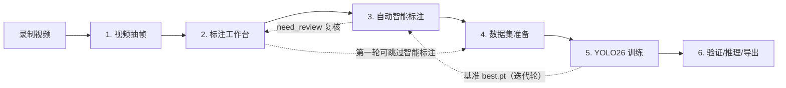

# 002 YOLO26 训练与自动智能标注使用说明

本文档介绍如何结合 **原生 PyQt6 标注工作台** 与 **自动智能标注（LLM / SAM 3）**，将抽帧后的图片高效制作成高质量 **YOLO26** 数据集，并在本地 GPU 上完成训练、验证、推理预览与模型导出。

---

## 1. 整体工作流

标签页按“采集 → 标注 → 智能标注 → 组装 → 训练 → 评估”排列，主流程从左到右推进：



- **第一轮（基准阶段 / 零样本与 SAM 3 冷启动）**：既可在「2. 标注工作台」少量人工标注后跳过第 3 步直接 `2 → 4 → 5` 训出基准 `best.pt`，也可以在尚无模型时直接进入「3. 自动智能标注」选择 **「LLM 零样本直接标注」**（推荐配合本地 SAM 像素级收紧）或 **「SAM 3 文本自动标注」**（本地免费出贴边框，可选叠加 LLM 二次质检）自动打出第一批标注，再回「2. 标注工作台」快速复核确认；若已有 `.json` 标注，也可在第 3 步用「已有标注 (.json) + LLM 质检精修」模式先做一次质检（不需要权重）。
- **迭代轮**：训练产出的 `best.pt` 自动带入「3. 自动智能标注」，低阈值预标后由 LLM 质检精修与收框，结果分流为：
  - `auto_passed`：高置信度/无误通过；
  - `llm_fixed`：LLM 自动改类/删误检/标准收框；
  - `need_review`：疑似漏标/框偏松待精修 → 回到「2. 标注工作台」重点复核。
- 智能标注结果发送到「4. 数据集准备」合并生成新数据集，再进入「5. YOLO26 训练」与「6. 验证、推理与导出」。

---

## 2. 使用原生标注工作台进行标注与复核（基准阶段 / 复核阶段）

1. 切换到软件的 **「2. 标注工作台」** 标签页（或在「1. 视频抽帧」完成后自动跳转），点击顶部 **「打开目录」** 选择要标注的目录（自动递归加载子目录图片与已有 `.json` 标注）。工作台采用左侧大画布 + 右侧三段可调卡片栏布局（上：类别清单、中：当前图目标框与按需展开详情、下：图片列表与进度管理）。
2. 如已有预置类别清单，可在右侧类别清单栏点击 **「导入」** 加载 `classes.txt`；也可直接输入新类别名称回车添加并一键 **「保存」** 为 `classes.txt`，右键类别项支持设为当前类别、重命名（同步更新当前图目标框并支持 `Ctrl+Z` 撤回）或从清单移除。打开包含已有 `.json` 的目录时，工作台会自动汇总已有类别并分配稳定配色。
3. **图片列表与高效标注/复核操作**：
   - **长名定位、进度条与快速跳页**：右侧底部图片列表采用中部省略显示（完整保留长文件名末尾帧号）与彩色状态圆点，上方配备实时完成度进度条、**页码直达框（「跳页」）** 及 **「下未标」** 一键定位下一张未标注/待复核图片。
   - **缩放与视野定位**：鼠标滚轮以指针下方目标位置为锚点无级缩放（≥ 200% 自动切换清晰像素显示，不漂移、不跑偏）；`+`/`=`（或 `Ctrl+=`）放大、`-`（或 `Ctrl+-`）缩小、`0`（或 `Ctrl+0` / 双击空白）适应窗口、`Ctrl+1`（或底栏 `1:1`）恢复原始像素；画布底栏提供快捷缩放百分比菜单，点击右侧目标框列表可自动将对应目标定位到当前视野内（列表双击或右键 **「聚焦居中查看」** 可自动放大并居中该框）。
   - **多通道自由平移**：支持 **编辑模式下左键拖拽空白处**、**抓手模式 (`H`) 下左键拖动**、**右键按住拖动**、**中键拖动**，以及在工作台任意非文本焦点下按住 **`Space+左键` 拖动**；四周留有充足缓冲空间，图像四角均可拖至屏幕中央精修。
   - **画框与精修**：`R` / `W` 进入**画矩形框模式**（双色高对比度全画布十字准星 + 实时尺寸提示 + 顶部轻量提示），同时支持**按住拖拽直接成框**与**轻点起点 → 移动/缩放/平移定位 → 再点终点**两点画框，拖拽接近画布边缘时自动平缓滚屏；`Q` 进入 **本地 SAM 2.1 点选标注模式**（零 API 费用：左键点击漏标目标主体生成实时贴边预览框，右键点击武器/特效等排除背景，`Backspace` 撤回上一个提示点，`Enter` 确认落框并继续点标下一个目标，`Esc` 取消草稿或返回）；`E` / `Esc` 返回**编辑模式**（支持拖拽控制点微调边框、整框平移及空白/框体右键快捷菜单）。
   - **选框微调与类别**：`Tab` / `Shift+Tab` 在当前图多个（含重叠嵌套）框间循环切换选中；选中框后按方向键 `↑↓←→` 进行 `1 px` 像素级微调、`Shift + 方向键` 进行 `10 px` 步进微调；`1`~`9` 快速切换前 9 个类别（编辑模式下选中框时直接改类，点选模式下仅切换待落框类别并实时刷新预览配色，也可双击框或右侧类别项改类）；`L` 快速显示/隐藏标签与置信度角标。
   - **切图、粘贴与保存**：`A` / `D`（未选中框时亦可按 `←` / `→`）切换上一张 / 下一张图片；勾选工具栏 **「保持视野」** 可在固定机位连续帧间保留当前缩放与局部观察位置；`Del` / `Backspace` 删除选中框；`Ctrl+D` 原图复制框；`Ctrl+C` / `Ctrl+V` 支持复制选中框或整图框并跨图原位粘贴；`Ctrl+Z` / `Ctrl+Y` 撤销与重做；`Ctrl+S` 立即保存（默认开启「自动保存」，切图自动落盘）。
   - `F`（**✓ 通过(F)**）：标记当前图已人工复核、清除 AI 漏标提醒并自动切至下一张（0 框时直接保存为显式空图负样本 `.json`，极适合快速过筛 `need_review/`）。
   - **AI 复核联动、本地 SAM 收框与单框 AI 精修**：当 `.json` 含有 LLM 漏标提醒时，画布顶部自动亮起黄色提醒横幅；选中任意框可在目标框面板下方展开查看 AI 置信度与审核理由，并可点击工具栏 **「SAM收框」**（或右键菜单/详情卡 **「SAM 贴边收框」**）调用本地 SAM 2.1 对选中框（未选中时为整图所有框）做像素级轮廓收紧；若遇到包含武器/特效、截断偏小或类别存疑的顽固单框，可按 **`G`**（或点击 **「AI修框」** / 右键菜单 **「AI 精修此框 (G)」**），复用第 3 页已配置的 LLM 与辅助判定规则，仅裁剪该目标周边局部放大图送检（不传整图、不审其他好框，极省 Token），自动修正边框尺寸、类别或剔除误检（全部改动均支持 `Ctrl+Z` 一键还原）。
4. 工作台保存的标准 `.json` 文件（与每张图片同目录同名）100% 兼容 LabelMe / X-AnyLabeling 格式，且无损保留历史文件中的非矩形形状；「4. 数据集准备」同时兼容 `.json` 与外部导出的 YOLO `.txt` + `classes.txt`。
5. 标注或复核完成后，点击顶部右上角 **「→数据集」** 或 **「→智能标注」** 继续下一步。

---

## 3. 自动智能标注（推荐）

无论你是**零样本冷启动的新项目**，还是已经用少量手动标注训练出了一个基准 `best.pt`（或已有外部 `.json` 标注结果），都可切换到 **「3. 自动智能标注」** 标签页批量出框，并自动解决**误检、错类、漏标与松框**问题：

1. **选择数据来源与预标模型（4 种工作模式）**：
   - **基准模型预标 + LLM 质检精修（推荐）**：加载基准 `best.pt`，建议将 `低阈值 Conf` 设为 `0.08 ~ 0.15`，先把潜在的弱特征目标尽可能召回，再交给 LLM 剔除误检与改错类；尚无模型时可切换零样本或 SAM 3 模式冷启动，或在「2. 标注工作台」标少量样本训练。
   - **已有标注 (.json) + LLM 质检精修**：直接扫描已有 `.json` 文件让 LLM 逐张质检、补漏与收框。
   - **LLM 零样本直接标注（冷启动，无需模型）**：无需预训练 `.pt` 权重或已有 `.json`，只需必填 **「目标类别清单」**（或点击「导入 classes.txt」），直接将原图发送给 LLM 按类别清单全图识别定位；推荐配合 **「本地 SAM 像素级收紧」** 对 LLM 输出的粗框自动做像素级贴边收紧（零额外 API 费用）。检出目标的图片统一分流至 `need_review/` 供工作台快速过目确认，确认无目标的背景图进入 `auto_passed/` 并写出空 `shapes=[]` `.json`。
   - **SAM 3 文本自动标注（本地免费 / 可选 LLM 质检）**：基于 Ultralytics `SAM3SemanticPredictor`，自动识别项目 `weights/sam3.pt`（或 `weights/sam3.1_multiplex.pt`；支持从魔搭社区 `facebook/sam3` / `facebook/sam3.1` 免审批高速下载，也支持 HuggingFace 官方权重；运行依赖 `pip install --no-deps git+https://github.com/ultralytics/CLIP.git && pip install ftfy regex timm`），按 **「目标类别清单」**（支持 `类别名=英文提示词` 语法，如 `人物=person, 安全帽=safety helmet`）直接输出像素级掩码贴边框：
     - **纯本地模式（默认，免 API Key）**：不调用 LLM，所有检出目标置信度均 `≥ 自动通过` 阈值时直接归入 `auto_passed/`，含低置信度框或 0 框图归入 `need_review/` 供人工核查；
     - **勾选「启用 LLM 二次质检」**：将 SAM 3 低阈值检出的贴边候选框送交 LLM 按中文业务规则执行删误检、改错类与漏标检查，兼得“免训基准模型 + 像素级贴边 + 复杂业务规则理解”。
   - **包含子目录**：位于「图片目录」正下方且默认勾选（与标注工作台和数据集页保持一致），可直接处理按视频或分流子目录组织的数据；若标注输出目录位于图片目录内部，会自动跳过其中的上一轮结果，避免重复处理。
   - **标注输出目录**：默认输出至 `data/smart_labeled`。
2. **大语言模型 (LLM) 配置**：
   - **Google Gemini API (`google-genai`)**：内置 Gemini 4 系列预设（`gemini-4-hydrogen` 推荐快速、`gemini-4-neon` 均衡、`gemini-4-argon` 高效推理、`gemini-4-carbon` 旗舰高精度），可在界面填 Key 或设置环境变量 `GEMINI_API_KEY`。
   - **OpenAI 官方 API (`api.openai.com`)**：独立直连 OpenAI 官方端点（无需填写 `Base URL`），内置 GPT-6.2 系列预设（`gpt-6.2-sol` 高效均衡推荐、`gpt-6.2-astra` 旗舰前沿），支持界面填 Key 或自动读取环境变量 `OPENAI_API_KEY`。
   - **OpenAI 兼容接口**：内置常用预设（**通义千问 DashScope Qwen-VL**、**硅基流动**、**本地 Ollama**、**本地 vLLM**），也可自定义 `Base URL` 与模型名（默认读取环境变量 `OPENAI_API_KEY`，本地或局域网服务可免填 Key）。
   - **思考/推理级别**：提供统一的多模型思考深度控制（`模型默认` / `关闭或极简` / `低` / `中` / `高` / `极高`）。默认 `模型默认 (auto)` 不额外传递参数，遵循服务端默认配置；界面会根据当前模型自动置灰不支持的档位并在切换模型时自动平滑回退（如 `gemini-4-carbon` / `gemini-4-argon` 自动禁用 `关闭/极简` 与 `xhigh` 并回退至 `high`，`gemini-4-hydrogen` / `gemini-4-neon` 与 `gpt-6.2` 自动禁用 `关闭/极简`，非思考直出模型如 `Qwen2.5-VL` / `gpt-4o` 自动锁定为默认），CLI 与底层引擎共享同一校正规则并会在服务端返回不支持的 400 错误时继续逐级降级。
   - **环境变量检测与一键测连通**：`API Key` 下方实时展示当前凭据来源（手动输入 / 已检测环境变量 / 本地接口免填 / 未配置），点击 **「测试连接」** 可在正式跑批量图片前快速验证 Key、网络代理与模型名是否可用；界面会自动记忆除 `API Key` 以外的常用参数配置（绝不明文保存密钥）。
3. **智能标注、收框与分流策略**：
   - **目标类别清单**：英文逗号分隔（如 `person, helmet`），支持点击 **「导入 classes.txt」** 一键载入，留空则自动从基准模型或 `.json` 中提取。
   - **辅助判定规则**：可填写你的标注口径（例如“远景模糊人影不标”、“反光背心只标穿在身上的”），能明显降低 LLM 误判。
   - **边框紧贴修正（解决预训练模型框偏松/包含过多背景）**：支持 4 种可选模式：
     - **关闭（仅改错类 / 删误检 / 补漏）**：保持现有框坐标不变，只做误检剔除、类别修正与漏标检查。
     - **仅标记过松框 → 转入待人工复核 (`flag_loose`)**：让 LLM 逐框评估紧贴度（`tight` / `loose` / `partial`）；发现偏松或截断的框不改动原坐标，直接标记为 `[Loose?]` 并分流至 `need_review/` 供人工精修。
     - **LLM 局部放大图精修 (`mllm_crop`)**：自动将候选框外扩 20% 裁剪放大后送交 LLM，在局部高分辨率视野内输出紧贴目标边缘的 `refined_box_2d` 坐标并映射回原图（开启此模式会自动强制附带局部裁剪放大图）。
     - **本地 SAM 像素级收紧 (`sam_local`，推荐高精度标准画框)**：基于 `ultralytics.SAM`（支持 `sam2.1_t.pt` / `sam2.1_s.pt` / `sam2.1_b.pt` / `mobile_sam.pt` 或本地自定义 `.pt`，首次运行可自动下载）以原框为 Box Prompt 分割目标前景掩码并在原框外扩 5% 容差内反算紧贴最小外接矩形；默认仅对 LLM 判定为偏松的框收框，也可勾选 **「全部保留框收紧」** 统一标准化全部有效框。
     - **安全门禁保护**：所有自动收框均受面积缩放比（`0.15 ~ 1.60`）与 `IoU ≥ 0.25` 双重门禁校验（`IoU ≥ 0.96` 且四边最大像素偏移 `≤ 2px` 时视为已紧贴保持不变）；一旦收框异常（如缩成噪声点或漂移到背景物体），自动拒绝修改并保留原框转入 `need_review/`，避免破坏标注质量。
   - **效率、并发与小批量试跑**：
     - 选定图片目录后下方实时显示待处理图片总数；建议首次调优规则或收框模式时点击 **「试跑 5 张」**（或调整处理数量数值框，CLI 可传 `--max-images 5`）先小批量验看效果，满意后再切回 `全部` 全量运行，避免误耗 API 额度。
     - 未勾选「检查漏标目标」且未启用 LLM 审框紧贴度时，所有框置信度 `≥ 免审阈值` 的整图会直接跳过 LLM 调用以省钱提速；开启漏标检查或收框评估时，该阈值自动切换为 `优先裁剪 <`（超额多目标图中优先放大低于该阈值的框）或停用。
   - **附带局部裁剪放大图**：自动将候选框外扩 20% 裁剪放大后一并送检，大幅提升小目标判别与收框准确率。
   - **检查漏标目标 & 尝试直接补充漏标框**：LLM 在核对现有框后还会巡检整图，发现未标注目标时尝试补充框并自动去重（同类 `IoU > 0.65` 自动过滤）。
4. **结果分流、筛选回看与标注工作台联动复核**：
   - 运行完成后会输出至三个子目录（同时生成 `classes.txt` 与 `review_report.json`）：
     - `auto_passed/`：全部框确认无误、紧贴且无漏标；
     - `llm_fixed/`：LLM 自动删除了误检框、修正了错误类别或通过安全门禁完成了紧贴收框；
     - `need_review/`：LLM 检测到疑似漏标、新增了补充框、存在待人工精修的偏松/超门禁框、给出了不在类别清单中的改类建议，或处理出错的疑难图片。
   - 右侧结果区提供 **实时计数分流筛选按钮**（`全部` / `自动通过` / `已删改/收框` / `待复核` / `出错`）及 **`收框`** 统计列，方便快速聚焦 `need_review` 与已收框样本；「结果列表」与「运行日志」合并为同一区域的两个页签（运行失败或连接测试失败时自动切到日志页），省出空间给下方对比预览。左右两栏之间、结果区与预览区之间均可拖动分隔条调整比例。
   - 支持点击 **「加载历史报告...」** 重新载入任意历史输出目录中的 `review_report.json`，无需重新请求 LLM 即可继续对比预览或双击跳转工作台精修。
   - 在右侧表格单击任意一行即可即时查看 **「处理前 vs 处理后」对比图**（上方附带各状态框色图例，右侧 After 图以**虚线**标出收框前原框、**天青实线 `[Tight]`** 标出收紧后标准框，待复核松框以洋红 `[Loose?]` 高亮）；预览图下方同步展示该图的 **LLM 逐框删改/收框判定理由** 及 **「在工作台精修此图 →」** 快捷按钮（也可直接双击表格行跳转精修）。
   - 点击 **「在工作台打开待复核目录」**，即可重点复核 `need_review/` 里的少数疑难图！
   - 点击 **「发送到「4. 数据集准备」→」**（会自动勾选“包含子目录”）把结果合入下一轮训练集。数据集页默认勾选 **「排除未复核的 need_review 子目录」**，只纳入 `auto_passed` 与 `llm_fixed`；在工作台复核完 `need_review/` 后取消该勾选，即可一并纳入。
   - 对同一输出目录重复执行智能标注时，同名图片在其他分流目录中的旧结果会被自动删除，不会同时出现在多个子目录中。如果在同一输出目录下复检 `need_review/`，图片会被移动到新的分流目录。
   - 多张图片同名（例如递归扫描时位于不同子目录）时，输出文件名会改为 `子目录__文件名__扩展名` 的形式加以区分。
   - 处理后没有任何框、且未开启「检查漏标目标」时，该空结果没有经过确认，因此只复制图片、不写出 `.json`，避免被当作负样本参与训练。

> [!TIP]
> **防止数据集退化**：请保留一批 **100% 人工精准核验的验证集（Val Set）**，不要将未经人工核查的伪标签直接混入验证集，以确保每一轮训练的 `mAP` 指标真实可信。

---

## 4. 标注转换与数据集划分

回到 **「4. 数据集准备」** 标签页：

> [!TIP]
> 左侧分为 **「1. 数据来源」**（图片目录、子目录选项、标注目录、标注格式、classes.txt 与「扫描标注统计」）和 **「2. 划分与输出」**（输出目录、划分比例、随机种子、负样本选项）两组。
>
> **子目录**：图片目录下方的 **「包含子目录」** 默认勾选，与标注工作台一致（工作台打开目录时同样包含子目录图片），可直接处理按 `video-001/`、`video-002/` 或自动智能标注分流的 `auto_passed/` 等子目录组织的数据；只想使用顶层图片时取消勾选。下方会实时显示当前范围内的图片数（「扫描标注统计」与「生成 YOLO26 数据集」都使用这一范围）；取消勾选后若顶层没有图片而子目录有图片，会以橙色提示重新勾选。

1. **标注目录**：若 `.json` 或 `.txt` 与图片在同一文件夹，保持留空即可；若单独导出到了其他文件夹，请选择该标注目录。
2. **标注格式**：默认选择 **「自动识别 (.json 或 YOLO .txt)」** 即可。
3. **classes.txt（可选）**：如需固定类别编号顺序（`0, 1, 2...`），可指定 `classes.txt`；若是从自动智能标注目录发送过来会自动填入并开启“包含子目录”。选择「YOLO 导出 .txt + classes.txt」格式时该栏标为“建议”：留空会在标注/图片目录中查找 `classes.txt`，找不到则使用 `class_0, class_1...` 作为临时类别名。
4. **划分比例**：默认 `Train = 0.8`、`Val = 0.2`、`Test = 0.0`（支持自定义随机种子 `Seed`）。三项之和不为 1 时按比例归一化，比例下方会实时显示实际划分占比；`Val` 为 0 时会提示验证指标将基于训练集、结果虚高。
5. 点击分组 1 中的 **「扫描标注统计」** 检查图片数、已标注/未标注数量（含显式负样本数）及各类别框数分布。
   - **显式负样本**：存在标注文件但其中没有任何目标（空 `.txt`，或 `shapes` 为空的 `.json`），视为人工确认的背景图，始终纳入数据集。
   - **「保留无标注文件的图片作为负样本」** 只影响完全没有标注文件的图片。
   - 损坏的标注文件会在告警中列出并跳过，不会中断扫描；递归扫描时若有同名图片，不会再回退匹配标注目录根部的同名标注，以免配错。
   - 类别表可按任意列排序：没有任何框的类别标红，框数不足最多类别 10% 的类别标橙，提示类别不均衡。
   - 修改任何参数，或在工作台保存了同目录的标注后，右侧结果会标记为“已过期”，需重新扫描或生成。
6. 点击 **「生成 YOLO26 数据集 (data.yaml)」**，工具将自动生成标准目录结构：
   ```text
   datasets/custom_yolo26/
   ├── images/{train,val,test}/
   ├── labels/{train,val,test}/
   ├── classes.txt
   └── data.yaml
   ```
   生成后会自动将 `data.yaml` 路径填入 **「5. YOLO26 训练」** 标签页，点击 **「前往「5. YOLO26 训练」→」** 可再次同步并切换过去（参数修改后需重新生成才可使用）。类别表会增加各划分框数列，验证集中缺失的类别标红并计入告警，可调大 `Val` 比例或更换 `Seed` 后重新生成。

> [!WARNING]
> 每次生成前会**清空**输出目录下的 `images/{train,val,test}`、`labels/{train,val,test}` 以及 `labels/*.cache`，以免上一次的划分文件残留，导致同一图片同时出现在训练集和验证集。若这些子目录已有文件，界面会先弹窗列出并请求确认。请不要在这些子目录中存放其他文件。递归扫描时，输出目录不能放在图片目录内部。

---

## 5. YOLO26 模型训练参数建议

切换到 **「5. YOLO26 训练」** 标签页：

- **计算设备（GPU 加速开关）**：界面顶部「1. 计算设备」集硬件状态检测与「启用 GPU 加速」开关于一体（单卡直接通过勾选切换 GPU/CPU；检测到多张 NVIDIA 显卡时自动浮现显卡选择与多卡并行下拉框；无独显时自动置灰并安全使用 CPU）。关闭 GPU 切为 CPU 模式时，下方「混合精度 AMP」会自动置灰；同理，在「3. 自动智能标注」与「6. 验证、推理与导出」页面也均提供统一的「GPU 加速」开关。
- **预训练模型（目标检测 Detect）**：
  - `yolo26n.pt`：Nano 轻量版，推理速度最快，适合边缘端或显存极低场景。
  - `yolo26s.pt`：Small 均衡版（**6GB 显存推荐默认值**），精度与速度表现均衡。
  - `yolo26m.pt` / `yolo26l.pt` / `yolo26x.pt`：精度更高，显存占用更大（6GB 显存使用 `m/l` 时建议将 `Batch` 调小至 `4~8` 或设为 `-1` 自动探测）。
  - 如需基于已有模型微调，可通过 **「选择本地 .pt」** 指定权重路径。
- **超参数预设（一键切换优化器与数据增强组合）**：
  - `通用自然场景 (Ultralytics 默认)`：`optimizer="auto"`、`NBS=64`、`Mosaic=1.0`、`Scale=0.5`，适合相机拍摄的常规场景。
  - `游戏画面 / UI 弱增强 (去畸变 + AdamW)`：自动切换为 `optimizer="AdamW"`、`LR0=0.001`、`LRF=0.05`、`NBS=16`，关闭 `Mosaic=0.0` 及旋转/错切/透视形变，并将 `Translate=0.03`、`Scale=0.15`、`HSV-S/V=0.2` 收窄，避免破坏固定界面比例与颜色语义。
  - `小样本 / 小目标平稳微调 (AdamW + 余弦退火)`：采用 `AdamW`（`LR0=0.001`、`NBS=16`、`cos_lr=True`）配合温和增强（`Mosaic=0.5`、`Scale=0.25`）。
  - 在预设基础上手动改动任一优化器或增强控件后，预设会自动切换为「自定义」，也可在 **「附加参数」** 输入框中按 JSON 或 `key=value` 格式（如 `box=7.5, weight_decay=0.0005, freeze=10`）覆盖任意其他 Ultralytics 参数（输入框下方会实时校验语法并提醒覆盖冲突）。
  - 支持 **「导入 JSON...」**（直接粘贴外部 `"arguments": { ... }` 片段或读取 `.json` 文件，自动回填界面控件，默认保护当前项目的路径字段不被误覆盖）、**「复制 JSON」**（一键复制当前整套训练超参数）、**「恢复默认」**，以及自动记忆上次训练参数配置（下次重启自动恢复）。
- **防呆联动与优化器 `LR0` 说明**：
  - 当优化器选为默认的 `auto` 时，界面会自动置灰 `LR0`（Ultralytics 会按数据集类别数与总步数自动选定优化器并覆盖 `LR0`）；显式选择 `AdamW`、`SGD` 等具体优化器后 `LR0` 自动恢复可编辑。
  - 填写「自定义权重路径」后上方官方模型下拉框会自动置灰（清空即可恢复）；将 `Mosaic` 设为 `0.00` 时 `CloseMosaic` 自动置灰；取消勾选「训练期验证 (`val`)」时 `Patience` 自动置灰；CPU 模式下 `AMP` 置灰且 `Batch` 自动限制为正整数（禁用仅 GPU 支持的 `-1` 自动探测）；勾选「断点续训 (`resume`)」时自动置灰会被断点原配置覆盖的超参数与增强项并展开生效范围提示；「3. 数据增强与附加超参数」面板可一键收起/展开以节省小屏空间。
- **推荐初始参数（RTX 3060 6GB）**：
  - `Epochs`: `100`（小数据集可先试 `50~100`，配合 `Patience=50` 早停；若将 `Patience` 设为 `0` 或等于 `Epochs` 则禁用早停）
  - `ImgSz`: `640`（小目标较多可尝试 `800` 或 `960`，需适当减小 `Batch`）
  - `Batch`: `16`（或设为 `-1` 让 Ultralytics 自动选择最大不爆显存批次；小样本小批次训练可将 `NBS` 调低至 `16` 以提高权重更新频次）
  - `AMP`: 勾选开启混合精度以节省显存并提速（追求严格确定性复现时可关闭 `AMP` 并固定 `Seed` + 勾选 `确定性算子`）
- **超参数日志与实时指标**：训练启动时，右侧全部实时指标与进度条会立即重置，并实时显示 `Epoch`、`训练时长`（`HH:MM:SS`）、`Box Loss`、`Cls Loss`、`Precision`、`Recall`、`mAP50`、`mAP50-95`；日志区会先输出提交给 Ultralytics 的完整 `"arguments"` JSON 配置，并在 `Trainer` 初始化完成后（含 `AutoBatch`、`optimizer="auto"` 自动推导或断点恢复结果）输出最终**实际生效训练超参数**明细；需要中断时请点击 **「安全停止训练」**，会在当前轮结束后保存断点权重并定格总训练时长。
- **实验目录不会被覆盖**：如果「实验名称」对应的目录已经存在，新的训练会自动保存到 `yolo26_train2`、`yolo26_train3` 等新目录，实际目录以训练结束时日志中的「结果目录」为准。
- **断点续训**：勾选「断点续训 (resume)」后，优先使用「自定义权重路径」中选择的 `last.pt`；未选择时使用 `保存根目录/实验名称/weights/last.pt`。找不到断点时会直接报错，不会悄悄从头训练。
- 关闭主窗口时如果仍有训练、抽帧或自动智能标注在运行，程序会先询问；确认后会请求这些任务安全停止，等它们全部结束后再退出。

---

## 6. 验证、推理预览与模型导出

训练完成后进入 **「6. 验证、推理与导出」** 标签页（`best.pt` 与 `data.yaml` 会自动带入，同时也会自动更新到「3. 自动智能标注」的基准权重栏）：

1. **自动读取模型元数据（同时支持 `.pt` 权重与已导出部署模型）**：
   - 顶部 **「模型文件」** 既可选择 `.pt` 源权重，也可直接选择已导出的 `.onnx` / `.torchscript` / `.engine` 模型进行验证与真实推理测试；
   - 选中模型后，工具会在后台只读解析其 **输入尺寸 (`imgsz`)、动态/静态属性、检测头能力（或已固化的输出模式）及有序类别清单（`0: ...`）**，在「权重信息」与日志区醒目展示，并自动同步尺寸与界面防呆状态；点击 **「类别清单」** 可查看并一键复制编号清单或纯类别名用于部署对接。
2. **运行验证 (Val) 与检测头选择**：
   - 使用分组 1 中的 `ImgSz` 与 `检测头` 在验证集上评估最终 `Precision`、`Recall`、`mAP50`、`mAP50-95`；
   - 选择 `.pt` 权重时可在 `one2many · 外部 NMS (PT 默认)` 与 `end2end · YOLO26 one2one 无 NMS` 之间切换检测头，同时作用于「运行验证 (Val)」与「推理效果测试」；选择已导出模型（如 `.onnx`）时自动按其固化的输出头和静态尺寸锁定执行。
3. **推理效果测试（支持复现导出效果与直接实测 `.onnx`）**：
   - 选择测试图片、图片目录或测试视频，调节 `Conf`（默认 `0.25`）与 `IoU`（默认 `0.45`；当处于 `end2end` 无 NMS 或图内嵌入 NMS 模式时 `IoU` 自动置灰），运行前日志区会输出本次提交给 Ultralytics 的完整推理参数，运行后可直接预览带检测框的结果图（支持双击预览图或点击 **「放大查看」** 以原图分辨率与 `Ctrl+滚轮` 缩放细检小目标）；
   - **预览样式**：默认采用 **「紧凑防重叠 (半透明，推荐)」** 渲染（自动按图幅与目标密集度收敛细框和紧凑字号、半透明标签底色配自动高对比文字、二维防重叠错层避让，置信度保持 `0.94` 格式），也可随时切换为 **「Ultralytics 默认」**，并独立调整 `线宽` 挡位（`自动` / `极细` / `适中` / `较粗`）及勾选/取消显示 `类别` 与 `置信度`（两者均取消时为纯框模式）；
   - **输入填充方式**：支持切换 **「最小矩形填充 (`rect=True`，PT 默认)」**、**「固定方形填充 (`rect=False`，模拟方形导出)」** 与 **「按导出尺寸固定填充 (`H×W, rect=False`)」**；
   - **一键「对齐导出参数」与实际参数摘要**：底部 **「实际参数」** 实时展示本次推理真正生效的模型类型、检测头、输入尺寸、填充模式与阈值；若当前 `.pt` 预览参数与下方第 3 组导出配置不一致（如检测头或填充方式不同），会自动橙色提示，点击 **「对齐导出参数」** 即可一键同步下方导出配置以提前复现导出后的真实表现；
   - **导出后一键切换实测**：成功导出 `.onnx` / `.torchscript` / `.engine` 后，右侧自动出现 **「测刚导出模型」** 快捷按钮，点一下即可切换上方模型实测刚导出的文件（如直接走 ONNX Runtime 推理），测完可点击 **「切回 .pt 权重」** 瞬间切回源 `.pt` 权重并保留自定义导出尺寸。
4. **独立模型导出面板**：仅对 `.pt` 源权重开放（选中已导出模型时自动置灰「导出模型」按钮防误触），支持导出为 `ONNX`（通用部署推荐）、`TorchScript` 或 `TensorRT (.engine)`，并提供独立且防呆联动的部署配置：
   - **独立导出尺寸**：支持方形联动（默认，如 `960×960`）或取消勾选后指定矩形 `高(H) × 宽(W)`（如 `544×960`），提供 **「用训练尺寸」** 一键恢复；与权重训练尺寸不一致或非步长 32 倍数时会在下方实时橙色提醒。
   - **批次、动态形状与算子**：支持 `Batch`、`动态尺寸/批次 (dynamic)`、`简化图 (simplify)` 与 `Opset`（自动或指定 `11~21`，切至 TorchScript 时自动置灰不支持的 ONNX 专属项）。
   - **NMS 输出模式与 MaxDet**：
     - `原始输出 · 外部 NMS (raw, nms=None)`：输出 `(B, 4+nc, anchors)`，与 YOLOv8/11 完全兼容，最适合 X-AnyLabeling 及已有外部 NMS 推理代码；
     - `端到端无 NMS · YOLO26 原生 (end2end, nms=False)`：启用 YOLO26 `one2one` 端到端头，直接输出 `(B, max_det, 6)`（`[x1, y1, x2, y2, score, class_id]`），推理端无需 NMS；
     - `图内嵌入 NMS (embedded, nms=True)`：在计算图内嵌入 NMS，输出 `(B, max_det, 6)`，并自动展开 `NMS Conf` / `NMS IoU` 阈值调节。
   - **ONNX 预处理元数据契约（单文件自描述）**：导出为 `ONNX` 时，可在 **「预处理」** 行选择写入 ONNX `metadata_props` 的缩放与填充策略（`居中填充` / `左上靠边填充` / `直接拉伸`）与 `补边值 (0~255，默认 114)`，不改动模型计算图、不影响 Ultralytics 原有字段，下游推理程序仅加载单个 `.onnx` 即可自动读取完整预处理/后处理协议（详见 [004_ONNX部署元数据契约说明.md](004_ONNX部署元数据契约说明.md)）；选偏离 YOLO 默认（居中灰边 `114`）的策略时会自动橙色提醒，切回 `TorchScript` / `TensorRT` 时自动置灰。
   - **实时输入/输出预览与 FP16**：面板底部实时展示当前参数对应的 `images` / `output0` 张量形状、预处理元数据摘要及风险提示；导出 `TorchScript` / `TensorRT` 时在 GPU 模式下可勾选 `FP16 半精度`，导出 `ONNX` 固定使用 CPU 以规避图追踪设备冲突，界面会自动置灰 `FP16 半精度`；在 CPU 模式下选择 `TensorRT (.engine)` 时会自动置灰「导出模型」按钮防误触。

> [!NOTE]
> 训练、LLM 基准模型预标、验证、推理预览与导出共享本地 GPU/计算设备互斥保护：其中一个正在运行时，启动另一个会先提示等待当前任务完成，避免显存溢出。

---

## 7. 命令行训练、导出与自动智能标注示例

```powershell
# 1) 转换标注 (.json / .txt) 为 YOLO26 数据集
.venv\Scripts\python.exe cli.py dataset -i "data\raw_frames" -o "datasets\custom_yolo26" --train-ratio 0.8 --val-ratio 0.2

# 2) 启动 YOLO26 基准模型训练（通用默认预设）
.venv\Scripts\python.exe cli.py train -d "datasets\custom_yolo26\data.yaml" -m yolo26s.pt --epochs 100 --imgsz 640 --batch 16 --device 0

# 2b) 游戏画面 / UI 弱增强预设 + 自定义细节参数训练
.venv\Scripts\python.exe cli.py train -d "datasets\custom_yolo26\data.yaml" -m yolo26s.pt --preset game_ui --epochs 160 --patience 160 --imgsz 960 --batch 4 --workers 0 --no-amp --no-plots --extra-arg "box=7.5, weight_decay=0.0005"

# 3) 查看 .pt 权重训练尺寸、类别顺序与预期导出输入/输出形状（不执行实际导出）
.venv\Scripts\python.exe cli.py export -w "runs\detect\yolo26_train\weights\best.pt" --inspect-only

# 3b) 导出 ONNX：不传 --imgsz 自动沿用训练尺寸；支持矩形 --imgsz 544,960、--dynamic、--batch、--nms 与 --opset
.venv\Scripts\python.exe cli.py export -w "runs\detect\yolo26_train\weights\best.pt" -f onnx --batch 1 --opset 17 --nms raw

# 3c) 导出 YOLO26 原生 NMS-free 端到端动态 ONNX（支持自定义写入 ONNX 元数据的 --preprocess 与 --pad-value），或导出 TensorRT FP16 引擎
.venv\Scripts\python.exe cli.py export -w "runs\detect\yolo26_train\weights\best.pt" -f onnx --imgsz 960 --dynamic --nms end2end --max-det 300 --preprocess letterbox_center --pad-value 114
.venv\Scripts\python.exe cli.py export -w "runs\detect\yolo26_train\weights\best.pt" -f engine --imgsz 960 --batch 4 --half --device 0

# 4) 基准模型预标 + Gemini 智能标注质检（需先设置 GEMINI_API_KEY 或传 --api-key）
.venv\Scripts\python.exe cli.py review -i "data\new_frames" -o "data\smart_labeled" -w "runs\detect\yolo26_train\weights\best.pt" --provider gemini --model gemini-4-hydrogen --yolo-conf 0.12

# 4b) 开启 LLM 局部放大图收框（--box-refine mllm_crop）或本地 SAM 像素级标准收框（--box-refine sam_local；--max-images 5 可先小批量试跑）
.venv\Scripts\python.exe cli.py review -i "data\new_frames" -o "data\smart_labeled" -w "runs\detect\yolo26_train\weights\best.pt" --provider gemini --model gemini-4-hydrogen --box-refine sam_local --sam-model sam2.1_t.pt --sam-refine-all --max-images 5

# 4c) 零样本冷启动直接标注 + 本地 SAM 像素级收边（无需 .pt 权重，必须提供 --classes）
.venv\Scripts\python.exe cli.py review -i "data\new_frames" -o "data\smart_labeled" --source-mode llm_zero_shot --classes "person,helmet" --provider gemini --model gemini-4-hydrogen --box-refine sam_local --sam-model sam2.1_t.pt --max-images 5

# 4d) 纯本地 SAM 3 文本自动标注（零 API 费用，无需 API Key；放入 weights/sam3.pt 后可省略 -w 自动识别；附加 --sam3-llm-review 可叠加 LLM 二次质检）
.venv\Scripts\python.exe cli.py review -i "data\new_frames" -o "data\smart_labeled" --source-mode sam3_text --classes "人物=person,安全帽=safety helmet" --yolo-conf 0.25 --high-conf-skip 0.80 --max-images 5

# 5) 使用 OpenAI 官方接口并显式指定推理级别，或使用通义千问 Qwen-VL 兼容接口执行 LLM 智能标注
.venv\Scripts\python.exe cli.py review -i "data\new_frames" -o "data\smart_labeled" -w "runs\detect\yolo26_train\weights\best.pt" --provider openai --model gpt-6.2-sol --reasoning-effort low
.venv\Scripts\python.exe cli.py review -i "data\new_frames" -o "data\smart_labeled" -w "runs\detect\yolo26_train\weights\best.pt" --provider openai_compat --base-url "https://dashscope.aliyuncs.com/compatible-mode/v1" --model "qwen-vl-max-latest"
```
